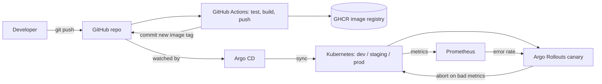
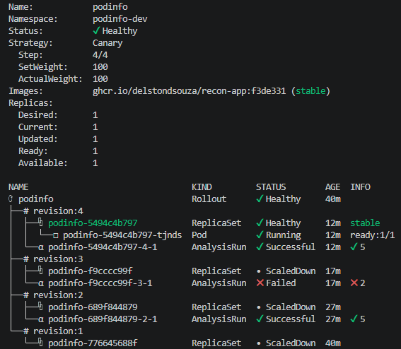
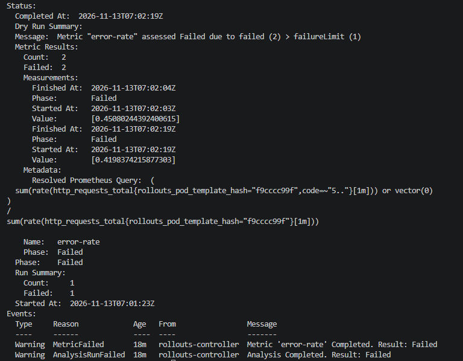

# RECON: A GitOps Platform – Canary Releases with Automatic Rollback

A Kubernetes delivery platform where **Git is the only way to change the cluster** and bad releases are **detected and rolled back automatically** using live metrics.

A deliberately buggy release (50% HTTP 500s) passed every Kubernetes health probe, and was still caught and aborted by metric analysis with no human involved.

## Architecture



## What it demonstrates

- **GitOps:** Argo CD syncs three environments from Git with self-heal and prune.
- **CI:** GitHub Actions runs tests, builds the image, tags it with the commit SHA, and commits the tag back to Git. CI never touches the cluster.
- **Environment promotion:** Dev deploys automatically; staging and prod are promoted through a manual workflow, so they only receive versions already proven in dev.
- **Progressive delivery:** Argo Rollouts canary (25% → 50% → 100%) gated by a Prometheus error-rate check.
- **Automatic rollback:** The bad release was aborted while the stable version kept serving.
- **Everything as code:** Even Prometheus is installed by Argo CD from this repo.

## The incident, end to end



1. **Good release (revision 2):** Canary passed 5 of 5 checks and was promoted to 100%.
2. **Bad release (revision 3):** I introduced a 50% error rate. Unit tests still passed. The canary pod passed its readiness probe because `/readyz` returned 200, so Kubernetes considered it healthy.
3. **Detection:** The AnalysisRun measured about 45% and 42% errors against a 5% threshold, failed twice, and aborted the rollout. The stable version kept serving throughout.
4. **Fix:** The controller's abort does not change Git, so I ran `git revert`. CI built a fixed image (revision 4), a new canary passed analysis, and the rollout returned to Healthy.



## Results

| Scenario | Outcome |
|:---|:---|
| Good release | Canary passed 5/5 checks and reached 100% in TODO min from `git push`. |
| Bad release (50% errors) | Analysis failed after 56 s (measured 45% and 42% errors vs. 5% limit); canary removed; stable version kept serving. |
| Manual `kubectl scale` on prod | Reverted by Argo CD self-heal in TODO s. |
| Pod deleted (Kubernetes self-heal) | Replacement Ready in 6 s. |

## Repo layout

| Path | Purpose |
|:---|:---|
| `app/` | Demo service (health, `/metrics`, configurable failure rate), tests, Dockerfile. |
| `apps/podinfo/base/` | Rollout, AnalysisTemplate, Service, load generator. |
| `apps/podinfo/overlays/{dev,staging,prod}/` | Per-environment config and image tags. |
| `argocd/apps/` | Argo CD Application definitions. |
| `platform/prometheus/` | Prometheus, installed via GitOps. |
| `.github/workflows/` | `ci.yml` (test, build, update dev) and `promote.yml`. |
| `scripts/` | Helper that rewrites image tags in an overlay. |
| `clusters/` | kind cluster config. |

## How the canary check works

The AnalysisTemplate asks Prometheus every 15 s (after a 40 s warm-up) for the share of the **canary pods'** requests that returned 5xx.

Canary pods are selected by the `rollouts-pod-template-hash` label, so healthy stable traffic can't dilute the result.

Under 5% passes. More than one failed measurement aborts the release.

## Run it yourself

1. Install Docker, kind, and kubectl.
2. Create a local Kubernetes cluster:

   ```bash
   kind create cluster --config clusters/kind-config.yaml
   ```

3. Install Argo CD and Argo Rollouts.
4. Apply the Argo CD applications:

   ```bash
   kubectl apply -f argocd/apps/
   ```

5. Fork the repo and point `repoURL` in `argocd/apps/*.yaml` at your fork.

## Limitations (honest review)

- Runs on a local kind cluster with synthetic traffic from a load-generator pod.
- No ingress or service mesh, so canary weights are approximated by pod ratios rather than exact request percentages.
- Prometheus is a minimal single instance with 2 h retention, not a production setup.
- The demo app is intentionally tiny; the focus is the delivery pipeline.

## Learning Outcomes

- Readiness probes can't catch a service that is up but wrong; metric-based analysis can.
- A controller abort protects users but leaves Git unchanged, so a `git revert` is still needed.
- Tagging images by commit SHA makes every running version traceable to one commit.
- Filtering analysis queries to the canary's pods matters, or good traffic hides the failure.

